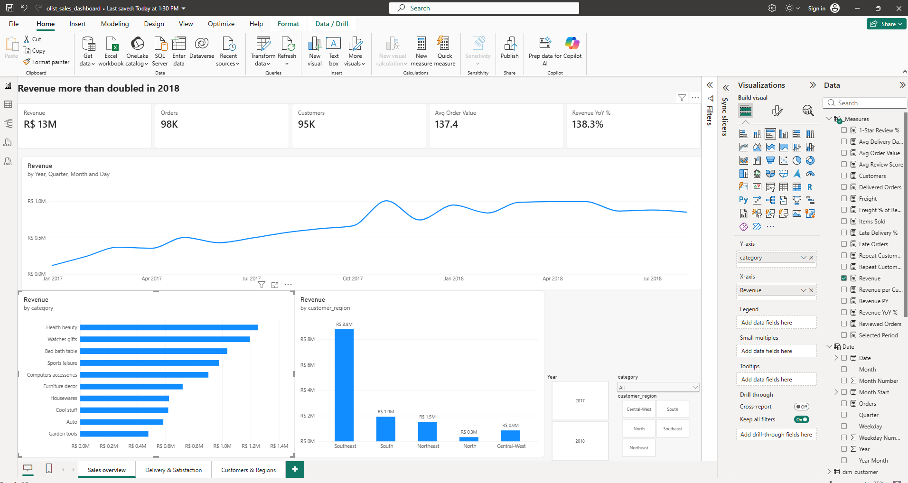
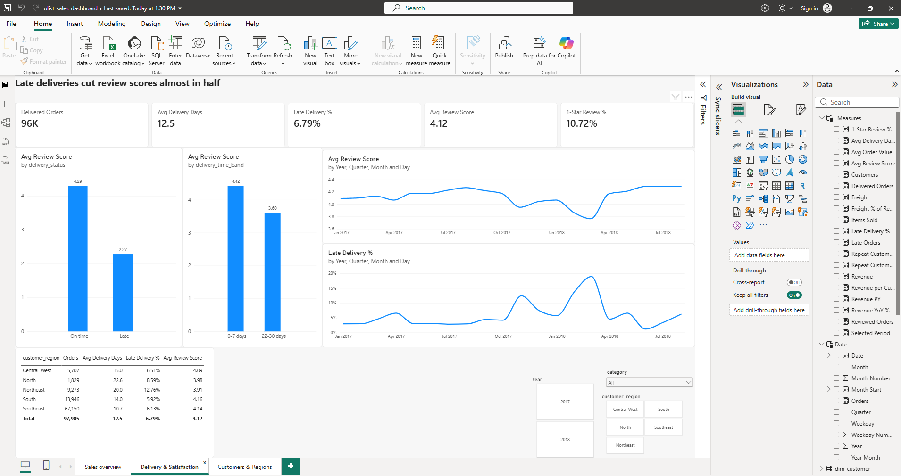
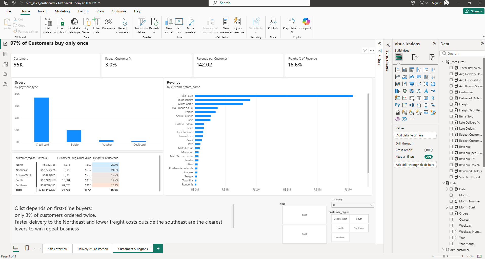

# Olist e-commerce: sales and delivery performance dashboard (Power BI)

A three-page Power BI dashboard on 97,905 real orders from Olist, a Brazilian e-commerce marketplace, covering January 2017 to August 2018. It answers three questions: how sales are growing, whether delivery performance affects customer satisfaction, and where customers are and whether they come back.

## Key findings

1. **Revenue more than doubled.** January to August 2018 revenue was R$ 7.3m, up 138% on the same months of 2017. Black Friday 2017 brought 1,166 orders in a single day, against a typical 150.
2. **Late deliveries wreck reviews.** On-time orders average **4.3 stars**, late orders **2.3**, and 54% of late orders get a 1-star review. The months with the most late deliveries (November 2017, February and March 2018) are the months review scores dropped.
3. **The Northeast is underserved.** Orders there take 20 days on average (11 in the Southeast) and are twice as likely to arrive late (12.8% against 6.1%).
4. **Shipping is expensive away from the Southeast.** Freight equals 23% of the product price in the North and 22% in the Northeast, against 15% in the Southeast.
5. **Almost nobody comes back.** Only 3% of customers ordered more than once.

**Recommendation:** delivery reliability is the clearest lever for satisfaction and repeat business. Start with logistics to the Northeast, where late deliveries are twice as common.

## Dashboard

### Sales overview


### Delivery and satisfaction


### Customers and regions


A PDF export of all pages is in [`powerbi/olist_sales_dashboard.pdf`](powerbi/olist_sales_dashboard.pdf), and the Power BI file is [`powerbi/olist_sales_dashboard.pbix`](powerbi/olist_sales_dashboard.pbix).

## Data model

A star schema with one fact table and four dimensions, all single-direction one-to-many relationships:

```
                 Date
                   │
dim_customer ── fact_sales ── dim_product
                   │
               dim_seller
```

| Table | Grain | Rows |
|---|---|---|
| `fact_sales` | one row per order line | 111,752 |
| `dim_customer` | one row per customer (person, not per order) | 94,703 |
| `dim_product` | one row per product | 32,578 |
| `dim_seller` | one row per seller | 3,029 |
| `Date` | one row per day, built in DAX | 608 |

**Grain matters for the measures.** Revenue belongs to the order line, but delivery time and review score belong to the order. Order-level measures take one value per order before averaging (`AVERAGEX(VALUES(order_key), …)`), so an order with three items isn't counted three times. All DAX is in [`powerbi/measures.dax`](powerbi/measures.dax).

## Data preparation

`src/build_model.py` turns Olist's eight raw tables into the star schema. The main decisions:

- Kept only complete months (January 2017 to August 2018). The 2016 launch period is sparse, and September 2018 is cut off.
- Removed 1,182 cancelled or unavailable orders, which never became sales.
- Where an order had several reviews, kept the latest. Orders without a review are left blank, not zero.
- Used `customer_unique_id` as the customer. Olist issues a new `customer_id` for every order, which would make every customer look new.
- Added English names for two categories missing from Olist's translation table, and labelled 600 uncategorised products "Unknown".
- Replaced long hash IDs with integer keys to keep the model small.

Every row removed or changed is listed in [`docs/data_quality_report.md`](docs/data_quality_report.md).

## Run it yourself

```bash
pip install -r requirements.txt
python src/fetch_data.py     # downloads the raw Olist tables (about 63 MB) into data/raw/
python src/build_model.py    # rebuilds data/processed/ and the data quality report
```

Then open `powerbi/olist_sales_dashboard.pbix` in Power BI Desktop and click **Refresh**.

## Data source

[Olist, Brazilian e-commerce dataset](https://github.com/olist/work-at-olist-data), published by Olist under the MIT License. Customer and seller identities are anonymised by Olist. Revenue is product price in Brazilian reais (R$), excluding freight.

## Skills demonstrated

Power BI (data modelling, DAX, time intelligence, conditional formatting, report design) · star schema design · Python and pandas for data cleaning · data quality documentation · turning findings into a business recommendation
